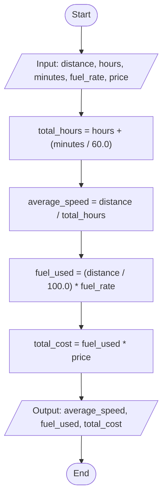
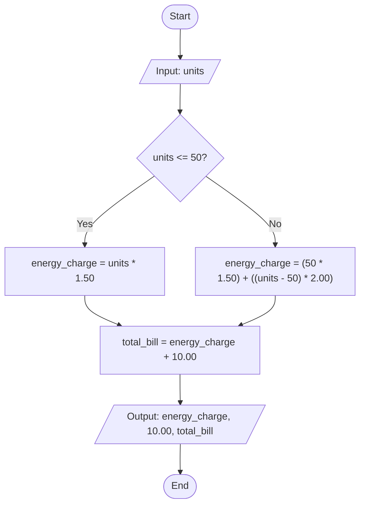
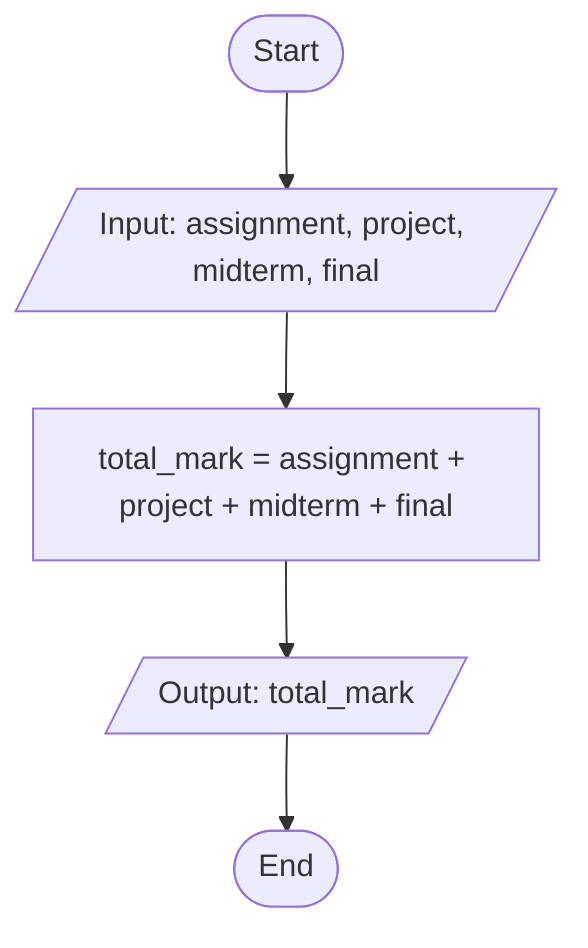

# C++ Assignment Flowcharts

This document contains the flowcharts for the three C++ programming assignments.

## 1. Trip Speed and Fuel Cost (trip_speed_fuel_cost.cpp)

## 2. Monthly Electricity Bill (electricity_bill.cpp)

## 3. Student Course Total (student_course_total.cpp)

