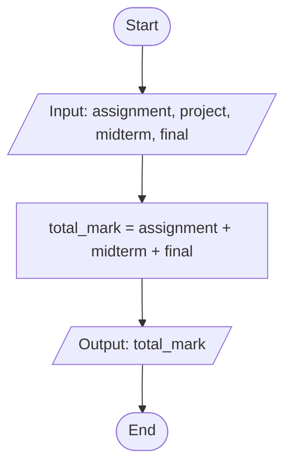

# C++ Assignment Flowcharts

This document contains the flowcharts for the three C++ programming assignments.

## 1. Trip Speed and Fuel Cost (trip_speed_fuel_cost.cpp)

This program calculates the average speed of a journey, the total fuel consumed, and the total cost of the trip. It processes distance, time (converting separate hours and minutes into a single decimal value), fuel consumption rate, and fuel price to generate the final trip summary.

## 2. Monthly Electricity Bill (electricity_bill.cpp)

This program calculates a customer's monthly electricity bill based on a tiered pricing structure. Operating strictly with conditional (ternary) operators instead of `if` statements, it applies a rate of 1.50 birr for the first 50 units, 2.00 birr for subsequent units, and includes a fixed service charge of 10.00 birr.

## 3. Student Course Total (student_course_total.cpp)

This program calculates a student's total accumulated grade for a course. It prompts the user to input individual scores for various assessments (assignment, midterm, and final exam) and computes the final aggregate mark.

